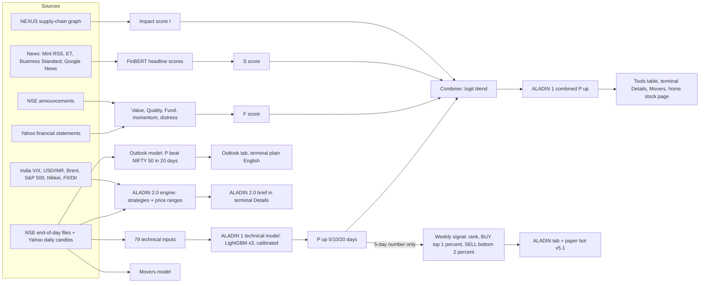

# How ALADIN works today

Written 2026-11-08 from the code on `main` and the data published for the 2026-11-06 close. Nothing was changed.
Words in *italics* are explained in GLOSSARY.md.

## 1.1 The big picture

ALADIN is five prediction systems that share data. Only **ALADIN 1** blends the three fronts you know (technical,
fundamental, sentiment). The **ALADIN tab** shows a different system (the weekly signal), which uses ALADIN 1's technical
5-day number and nothing else.

**Walkthrough.** Every evening after the market closes the *Daily update* job saves the day's prices and runs the
Outlook model. When it ends it starts *ALADIN nightly*: it refreshes about 400 companies' statements, scores filings,
computes the supply-chain impact, builds 79 technical inputs for every stock, runs the technical model for 5, 10 and 20
days, converts its raw score into a *calibrated* probability, and blends it with the fundamental and sentiment scores.
Then *ALADIN2 nightly* starts: it runs the ALADIN 2.0 engine, writes the weekly BUY/SELL list from the technical 5-day
number, and updates the paper bot. The sentiment job runs separately about every 30 minutes. The website reads the
saved files; the colour you see is chosen in the browser by fixed cut-offs (section 1.5).

## 1.2 Data, source by source

| Source | Gives | Fetched by | Updates | Usual age when used | When missing or late |
|---|---|---|---|---|---|
| NSE end-of-day files + Yahoo candles | daily open/high/low/close/volume, split-adjusted (not dividend-adjusted) | nse_eod.py, terminal_hist.py (Daily update) | every evening | same day's close | a stock whose last bar is >10 days old is not scored (aladin_model.py) |
| Yahoo statements | annual + quarterly income, balance sheet | aladin_fund.py, ~400 companies a night | rotating; each company every few nights | days to weeks; **filing dates not stored** | F is None, its weight drops out of the blend (counted as 0). RELIANCE has no F today |
| NSE announcements | text of filings, scored by FinBERT | aladin_filings.py | nightly, last 90 days, 15-minute budget | 1 day | the NLP part of F is left out |
| News | headlines | aladin_sentiment_engine.py, news_wire.py | about every 30 min | minutes to hours; decays with a 24-hour half-life-like weight | S is None, counted as 0 in the blend (most stocks: only 2 headlines for RELIANCE, none for PERSISTENT, SAILIFE) |
| Market series (VIX, INR, Brent, S&P 500, Nikkei, US 10y) | context for ALADIN 2.0 | ALADIN2 nightly | daily | 0–1 day | the feature is empty that day |
| FII/DII flows | net buying | institutional.py | daily | 1 day | last saved day kept; used inside sentiment as "flow" |
| NEXUS graph | supply-chain links | nexus.yml, graph_impact.py | weekly | days | I is None (true for almost every stock) |
| Liquidity sweeps | live price patterns | the owner's PC only | live | – | absent on GitHub, so always 0 in the nightly blend |

**Silent fills.** In the blend, a missing F, S, I or sweep counts as **0** (no push either way). The technical model
itself lets LightGBM handle missing inputs (it sends them down a learned branch). Nothing is filled with an old value
except prices (last saved copy).

## 1.3 Inputs ("features")

**Technical, 79 inputs in total** (scripts/predict_model.py `features`, scripts/aladin_model.py `stock_frame`, `build_dataset`):

| Group | Inputs (code name: meaning) | Look-back | Scaling |
|---|---|---|---|
| Returns | r1, r5, r10, r20, r60, r120, r250: log change in price over 1 day to 1 year; mom12_1: 1-year minus 1-month return | 1–250 days | raw; several also ranked 0–1 across stocks that day (`_rk`) |
| Trend | d_sma20/50/200: price ÷ its 20/50/200-day average − 1; sma50_slope, sma200_slope: change of those averages over 10/20 days | 20–220 days | raw |
| Oscillators | rsi2, rsi14 (relative strength 0–100), stoch14 (where the close sits in the 14-day range), cci_z, adx (trend strength), di_diff, macd_h, bb_pct, bb_w | 2–26 days | raw |
| Volatility | atr_pct (typical daily range ÷ price), vol20, vol60, vol_ratio, skew60, range20, gap20 | 14–60 days | raw |
| Position | hi52, lo52 (distance from 52-week high/low), dd60 (fall from the 60-day high) | 60–252 days | raw |
| Volume | vz20 (today's volume vs its 20-day average, log), vtrend, turn (traded value) | 5–60 days | raw |
| Market link | beta, corr60, idio60 (stock-specific volatility), rel20, rel60 (return vs NIFTY 50), sec_rel60 (vs its sector) | 20–250 days | raw |
| Market-wide | m_r5/20/60 (NIFTY returns), m_d200, m_vol20, m_br50/m_br200 (share of stocks above their 50/200-day average), m_disp | 5–200 days | same for every stock that day |
| Quant extras | pca_z, pca_r2 (move not explained by market factors), coint_z, coint_hl, coint_p (gap to a paired stock), hmm_p_highvol (chance the market is in a turbulent state), jump_lam, jump_recent, jump_bv | 20–250 days | raw |
| Ranks | 17 of the above ranked 0 (lowest) to 1 (highest) among that day's liquid stocks | – | percentile |
| Labels | ind: industry (category) | – | category |
| **Calendar** | **moy: month of the year (1–12); dom: day of the month (1–31)** | – | raw. Added because it "improved 8 of 13 test years" |

**Fundamental** (aladin_fund.py): value, quality, fundamental momentum (each a z-score, compared across companies),
NLP tone of filings, distress band. `F = 100 × tanh(z ÷ 1.5)` where `z = 0.35 value + 0.35 quality + 0.20 momentum
+ 0.10 NLP − distress penalty` (weights re-scaled over the parts present). Range −100 to +100.

**Sentiment** (aladin_sentiment_engine.py): each headline gets FinBERT's P(positive) − P(negative); weighted by age
(`exp(−hours ÷ 24)`) and source; per stock `raw = 0.60 news + 0.15 retail + 0.15 FII/DII flow` (re-scaled over the
parts present) **plus a hand-set geopolitical adjustment** (`geo_adjust`, from geo_exposure.json); `S = 100 × raw`,
clipped to ±100. Levels: BAD ≤ −60, POOR ≤ −20, NEUTRAL, GOOD ≥ 20, EXCELLENT ≥ 60.

## 1.4 Each model

| | ALADIN 1 technical | Outlook | ALADIN 2.0 engine | Weekly signal | Movers |
|---|---|---|---|---|---|
| Type | machine learning: 3 LightGBM tree models (different random seeds), averaged; for 10 days a calm/stressed blend | machine learning: 3 LightGBM classifiers + 1 regressor, rank-averaged | strategy library (trend, reversal, volatility, relative strength, delivery), strategy life cycle, volatility model for ranges | a rule on ALADIN 1's number | machine learning |
| Predicts ("target") | close in 5/10/20 trading days > today's close (raw direction, **no costs**, not vs the market) | 20-day return beats NIFTY 50's | per strategy: net return after costs; ranges: price quantiles | next 5 days, enter next open | 5-day move size and direction |
| Trained on | 2008/2009 onward, main-board stocks with ≥ ₹5 Cr a day **on that day** (point in time); walk-forward, test years 2013–2026 with a 15-day gap; final model retrained nightly on everything | NIFTY 500 **as of today** (today's list), 2008 onward, walk-forward 2013–2026, 25-day gap | 2005 onward, test from 2012-07, 63-day blocks, 20-day purge + 5-day embargo | the weekly study 2013–2026 (310,816 stock-weeks) | 2016–2026 |
| Outputs | calibrated probability 2–98% | calibrated probability, decile | product state; forecast range; signal only if Validated | BUY / SELL / HOLD, a stop, a "target" | size + direction |
| Thresholds and where from | calibration: isotonic map fitted on the 2013–2026 unseen-year record; confidence Low < 3 pts from 50%, Medium < 7, else High | none for the colour | Validated: ≥ 60 unseen trades, ≥ 60 live days, calibration error ≤ 5%, net ≥ 5 bps; kill switch at calibration error > 5% | BUY ≥ 99th percentile, SELL ≤ 2nd (tested: chosen on 2013–2020, held on 2021–2026); stop = 2 × ATR | pre-declared gates |
| Weight in a blend | the base of the ALADIN 1 blend | – | – | – | – |
| Measured skill (unseen data) | AUC 0.546 at 10 days (0.5 = chance); top tenth went up 54.3%, bottom tenth 43.5% | AUC 0.534 | live: **suspended** (see 1.7) | BUY top 1%: +27 bps a week after costs in the study | direction AUC 0.511: **failed** |

**The ALADIN 1 blend** (scripts/aladin_model.py `combine_py`, identical in desk-aladin.js):
`logit(p) = logit(p_technical) + 0.20 × F_adj/100 + 0.12 × S/100 + 0.18 × sweep/100`, with `F_adj = F − I`.
Weights 0.20 / 0.12 / 0.18 are **set by hand ("prior")**: a fitted blend is only tried after 120 trading days of matured
live predictions (16 so far). Missing parts count as 0. Result clipped to 2–98%.

## 1.5 From a number to a colour

| Page | Number shown | Green | Grey | Red |
|---|---|---|---|---|
| ALADIN tab, signal badge | weekly signal | BUY (rank ≥ 99th percentile) | HOLD | SELL (rank ≤ 2nd) |
| ALADIN tab, "stop loss" cell | distance of the stop from the price | stop above price | – | **stop below price: always, for every BUY** |
| ALADIN tab, "target" cell | distance of the range edge | above price | – | below price ("not measured" for 12 of 13 BUYs this week) |
| Terminal Details, Tools table (`probBar`), Movers | ALADIN 1 combined P(up), 10 days | ≥ 55% | 45–55% | ≤ 45% |
| **Home stock page, "What our models see"** | ALADIN 1 technical P(up) at 5, 10, 20 days | **≥ 50%** | – | **< 50%** |
| Outlook tab, terminal | P(beat NIFTY 50) | ≥ 55% | 45–55% | ≤ 45% |
| ALADIN 2.0 brief | product state | Validated + signal | Provisional / HOLD | – |

**Today's spread of ALADIN 1 (2026-11-06 close, 2,458 stocks).**

| Horizon | Lowest | Median | Highest | Stocks above 50% | Different values |
|---|---|---|---|---|---|
| 5 days (technical) | 45.3% | 51.6% | 52.4% | 85.6% | 17 |
| **10 days (technical)** | 41.0% | **44.5%** | **50.0%** | **0%** | 21 |
| 20 days (technical) | 45.9% | 48.5% | 53.8% | 16.3% | 19 |
| 10 days (combined) | – | 44.5% | – | 0.3% | – |

What this means: on every page that colours ALADIN 1's 10-day number, no stock can be green, and on the home stock page
every stock's 10-day bar is red. The 13 BUY stocks on the ALADIN tab all have the same 5-day value, 52.4%.

## 1.6 Three worked examples (2026-11-06 close)

### RELIANCE (large-cap)
| Step | Numbers | What happened |
|---|---|---|
| Raw data | close ₹1,320; +6.8% vs 50-day average, −0.4% vs 200-day; 1 month +9.3%, 1 year −11.3%; 82% of its 52-week high; volume 1.09× normal | a recovering large-cap, flat on the year |
| Technical model | P(up) 5d 51.6%, **10d 44.3%**, 20d 49.5% | the 10-day number is low |
| Biggest reasons (10-day, in log-odds) | **day of month −0.245**, industry +0.042, month of year +0.039, 1-week return rank −0.024, RSI(2) −0.020 | the calendar alone outweighs everything about the company |
| Fundamental | F = **none** (no statements in the data) | counted as 0 |
| Sentiment | S = +28.9 (GOOD, 2 headlines) | small push up |
| Blend, 10 days | logit(0.443) = −0.229; + 0.12 × 28.9/100 = +0.035; total −0.194 → **45.2%** (published 45.05%) | blend reproduced by hand |
| Colour | Terminal: grey (45–55%). Home stock page: 10-day bar **red**. Weekly rank 50th percentile: HOLD | |

### PERSISTENT (mid-cap)
| Step | Numbers | What happened |
|---|---|---|
| Raw data | close ₹6,053.5; +7.1% vs 50-day, +13.8% vs 200-day; 1 month +9.9%, 3 months +10.9%; 92% of its 52-week high | in an uptrend |
| Technical model | 5d 52.4%, **10d 46.8%**, 20d 52.7% | |
| Biggest reasons | **day of month −0.240**, industry +0.139, month +0.030, 1-week return rank +0.019, 52-week-high rank +0.013 | calendar again the largest |
| Fundamental | value −0.87, quality +0.06, momentum +0.17, distress Low → F = −21.8 | expensive, so a push down |
| Sentiment | none | 0 |
| Blend, 10 days | −0.128 + 0.20 × (−21.8)/100 = −0.044 → −0.172 → **45.7%** (published 45.7%) | |
| Colour | Terminal: grey. Home stock page: 10-day bar **red**. Weekly rank 88th percentile: HOLD. Outlook 50.6% (decile 7) | |

### SAILIFE, Sai Life Sciences (should look bullish)
| Step | Numbers | What happened |
|---|---|---|
| Raw data | close ₹1,785.1; **98.4% of its 52-week high**; +16.6% vs 50-day, +47.1% vs 200-day; 3 months +26%, 1 year +94%; **volume 11.8× normal** | a textbook breakout on heavy volume |
| Technical model | 5d 51.6%, **10d 44.1%**, 20d 50.6% | reads as below a coin flip |
| Biggest reasons | **day of month −0.227**, industry +0.101, 1-week return rank −0.026, month +0.026, RSI(2) −0.020 | the breakout is not among the top reasons |
| Fundamental | value −1.07, quality −0.28, momentum +0.99, distress Low → F = −8.2 | |
| Sentiment | none | |
| Blend, 10 days | −0.237 + 0.20 × (−8.2)/100 = −0.016 → −0.254 → **43.7%** (published 43.65%) | |
| Colour | Terminal: **red** (≤ 45%). Home stock page: 10-day bar **red**. Weekly rank 39th percentile: HOLD. Outlook 47.6% | |

## 1.7 Health snapshot (2026-11-08)

| Item | State |
|---|---|
| ALADIN 1 | probabilities as of 2026-11-06; models retrained every night; unseen-year record and calibration last rebuilt up to 2026-09-15 (10-day) |
| Outlook | as of 2026-11-06; record to 2026-10-08 |
| ALADIN 2.0 engine | **all 1,382 stocks Suspended by its own kill switch**: live calibration error 14.7% (limit 5%); live 50% range caught the price 44.5% of the time, 80% range 75.2%. So no ALADIN 2.0 signal anywhere |
| Weekly signal | as of 2026-11-06: 13 BUY, 26 SELL, 1,245 HOLD; all "Provisional" (no live record yet) |
| Movers | failed its own test (direction AUC 0.511); its live list is not on `main` |
| Fitted blend | not tried yet: 16 of 120 matured days |
| Sweep and impact terms | not validated: both effectively 0 |
| Jobs | last 6 runs of ALADIN nightly, ALADIN2 nightly and ALADIN sentiment all succeeded. ALADIN nightly ran 6 times in 15 hours on 7–8 Nov because Daily update ran 5 times (schedule, re-starts and a failed run); each Daily update starts the ALADIN chain. Harmless but wasteful |
| Tests | 288 ALADIN 2.0 + ALADIN Python tests pass; 34 of 35 ALADIN 1 model tests pass (the one failure is a timing test that depends on this PC's speed, known before); 33 browser-code tests pass |
| Data gaps | RELIANCE and others without statements (F none); news covers few stocks; filing dates not stored; past NIFTY 500 lists not available; the Outlook model trains on today's NIFTY 500 list |
