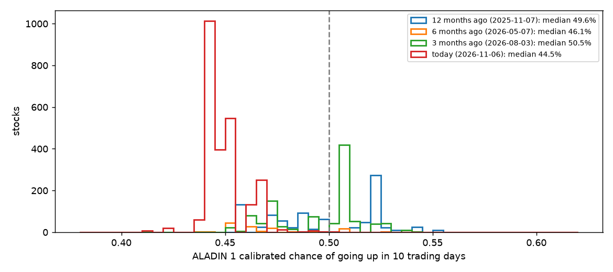
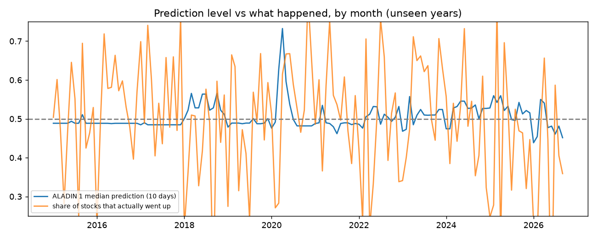
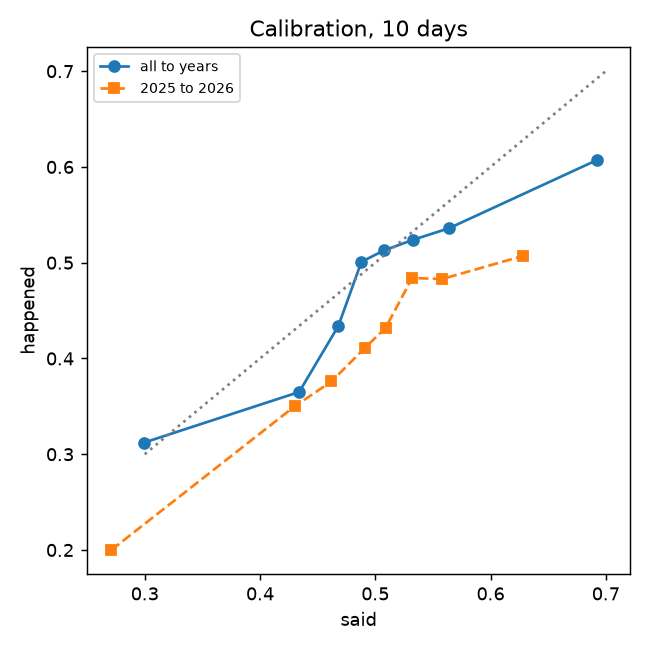

# ALADIN audit, Phase 2: why every long looks red

Written 2026-11-08. Read-only: nothing in ALADIN was changed. Every number comes from `aladin-audit/scripts/phase2_checks.py`
(results in `aladin-audit/phase2/results.json`). "Unseen data" = ALADIN 1's own walk-forward record, 2015 to Sept 2026, about
300,000 stock-dates per horizon. Costs: 37 bps (0.37%) per round trip.

## The answer in one paragraph

It is **mostly design, partly a real market reading, and partly the way the pages colour numbers**. ALADIN 1's 10-day number is
below 50% for every stock today mainly because of a **calendar input (the day of the month)** that pushes every stock down by the
same amount; it is the biggest reason for all 2,458 stocks. ALADIN's overall level (how bullish it is about everything at once)
has almost no link to what then happens (correlation 0.13 over 571 dates). Two pages then turn that level into colour: the home
stock page paints anything under 50% red, and the ALADIN tab paints every BUY's stop loss red because a stop sits below the
price. The market itself is mixed: the indices are healthy, but only 22.5% of NIFTY 500 stocks are in an uptrend. ALADIN's real
skill is in **ordering** stocks, not in its overall level, and that skill after costs is small except at a 20-day hold.

## 2.1 Bug checks

| Check | Evidence | Verdict |
|---|---|---|
| 1. Sign and direction | In the unseen record, stocks given higher chances went up more often (calibration rises bucket by bucket, table in 2.2.3). The blend adds fundamental and sentiment with the right signs (hand recomputation in Phase 1 matched). | No flip |
| 2. Colour mapping | Home stock page: 2,456 of 2,458 stocks red at 10 days (rule: below 50% = red). Terminal: 0 green, 983 grey, 1,475 red. ALADIN tab: every BUY's stop is red (a stop is always below the price). | **Design flaw in presentation** |
| 3. Missing data | Missing today: fundamental 462 stocks (including RELIANCE), sentiment 2,353, supply chain 2,450. Known-good test: even with the best possible fundamental and sentiment (+100 each), the median 10-day chance would only reach 52.5%, the best 57.9%. | Not the cause; a coverage gap |
| 4. Date alignment | The as-of date (6 Nov) equals the last NSE session; targets use the close h days later; the code asserts a purge gap longer than the horizon. | OK |
| 5. Stale data | Prices, ALADIN 1, Outlook, weekly signal: 6 Nov close. Sentiment: hourly. | OK |
| 6. Units and scaling | F and S are on −100..+100 and divided by 100 in the blend, as documented. | OK |
| Extra: the reasons list | The per-stock "reasons" exclude market-wide inputs but **not** the calendar inputs, so "day of month" is listed as the top reason for every stock. | **Bug (explanation)** |

## 2.2 Design checks

**1. Target balance.** Share of 10-day windows that went up, by year: 2015 48.7%, 2016 53.1%, 2017 57.4%, 2018 42.3%,
2019 47.4%, 2020 54.8%, 2021 53.2%, 2022 46.7%, 2023 57.2%, 2024 49.2%, **2025 44.2%, 2026 43.6%**. The win definition ("closes
higher", no costs) is balanced. It is not too strict.

**2. Score level through time.**

What this means: today (red) every stock is bunched between 41% and 50%. Three months ago the median was 50.5%, a year ago
49.6%. The drift score (population stability index) of today's spread against the record is 9.3, where anything above 0.25
means "shifted": today is far outside anything in the record.

What this means: ALADIN's level (blue) barely moves while what actually happened (orange) swings widely. Across 571 dates the
day's average prediction and the day's actual share of risers are correlated at only **0.13** (0 = no link).

**3. Calibration** (said vs happened, 10 days).

| Said | Happened, all years | Happened, 2025–2026 |
|---|---|---|
| 40–45% | 36.5% | 35.0% |
| 45–48% | 43.4% | 37.6% |
| 48–50% | 50.1% | 41.1% |
| 50–52% | 51.3% | 43.2% |
| 52–55% | 52.4% | 48.4% |
| 55–60% | 53.6% | 48.3% |
| over 60% | 60.7% | 50.7% |

What this means: the order is right (higher said, higher happened), but in 2025–2026 every bucket happened 4 to 13 points less
often than said. The percentages are too optimistic recently, not too gloomy.

**4. Threshold sweep, and your goal of lowering filters.** Net of costs and **measured against the market** (the average stock
on the same dates):

| ALADIN 1, hold | Top 1% | Top 5% | Top 10% | Top 20% | Top 50% |
|---|---|---|---|---|---|
| 5 days | +10 bps | +4 | −9 | −15 | −23 |
| 10 days | +18 bps | +3 | 0 | −13 | −15 |
| **20 days** | **+44 bps** | **+56** | **+36** | **+19** | +2 |
| 20 days, 2021–2026 only | +29 | +42 | +22 | +6 | +1 |

Weekly signal (5-day hold, from its own study): top 1% +27 bps, top 2% +15, top 5% +1.5, top 10% **−6.8**.

What this means: at a 5- or 10-day hold, costs eat the edge as soon as the filter is loosened. At a **20-day hold**, loosening to
the top 5–10% keeps a positive edge with 6 to 12 times more trades. Year by year it swings (20-day top tenth: +132 bps in 2018,
−59 in 2023, −50 in 2026 so far), so Phase 4 must test it properly before anyone relies on it.

**5. Drift.** See 2.2.2: today's scores are far outside the record (score 9.3). The live snapshots since 29 Sept agree: the
10-day forecast averaged 50.9% while only 32.2% of stocks rose (1–16 Oct, a falling market), then 56–59% when 57–79% rose.
Five weeks is too short to judge on its own.

**6. Overfitting.** I am not sure: ALADIN does not store its training-data accuracy, so the gap between training and unseen
accuracy cannot be read from the files. It can be measured by retraining in Phase 4. On unseen years, skill (AUC) moved between
0.49 (2015) and 0.67 (2026), with 2025 the weakest recent year (0.51). Within a single day the average AUC is 0.54.

## The calendar inputs (the main cause of the level)

| Day of month | ALADIN said | Happened | 2013–2019 happened | 2020–2026 happened |
|---|---|---|---|---|
| 1–5 | 50.2% | 47.0% | 48.1% | 46.6% |
| 6–10 | 50.1% | 49.3% | 50.7% | 48.8% |
| 11–15 | 49.5% | 44.4% | 45.6% | 44.0% |
| 16–20 | 51.5% | 52.7% | 58.1% | 51.3% |
| 21–25 | 51.6% | 49.7% | 49.6% | 49.7% |
| 26–31 | 52.0% | 54.8% | 48.5% | 57.1% |

What this means: some days of the month were weaker in both halves of history (11–15), but days 6–10, today's slot, were close
to normal. Yet today the day-of-month input alone pulls every stock down by about 0.25 on the log-odds scale, roughly 6
percentage points. Removing that push would put today's median near 50.6% (approximate, because calibration is not a straight
line). A calendar input is the same for every stock on a date, so it **cannot help choose between stocks**; it only moves
everything up or down together, which is exactly what drives the colour.

## 2.3 Is the market actually weak?

| Measure | Value | As of |
|---|---|---|
| NIFTY 50 | 24,986; 7.4% above its 50-day average, 4.1% above its 200-day; −3.0% in a year | 2026-11-08 (Yahoo) |
| NIFTY 500 | 23,489; 4.4% above 50-day, 3.2% above 200-day; −0.9% in a year | 2026-11-08 |
| India VIX | 18.4, up 21% in a month and 52% in 3 months; higher than 82% of the last 5 years | 2026-11-08 |
| Breadth, NIFTY 500 | 44.7% above their 200-day average; 45.5% above their 50-day; **22.5% in an uptrend** (price above 50-day, 50-day above 200-day) | 2026-11-06 (NSE) |
| FII / DII cash, last 20 sessions | FII **+₹37,008 Cr** (net buying), DII +₹2,412 Cr | 9 Oct to 6 Nov |
| Rupee | ₹93.9 per US dollar, weaker than 88% of the last 5 years | 2026-11-08 |
| Brent crude | $98.3, +12% in 3 months, higher than 84% of the last 5 years | 2026-11-06 |
| Upcoming | Q2 results season is under way (October–November). Next RBI policy: I am not sure of the date (usually early December); check rbi.org.in. Union Budget: usually 1 February. | |

Neutral rule today: 22.5% of NIFTY 500 stocks in an uptrend. ALADIN 1 at 10 days: 0.1% of stocks above 50%. ALADIN 1 at 5
days: 85.6% above 50%. What this means: the typical stock is weak, so some red is fair, but ALADIN's 10-day view is far more
negative than the market, and its own 5-day view says the opposite. The level is not a reliable reading of the market.

## 2.4 Politics, policy and global events

Hand-set opinions found: the sentiment score adds a **geopolitical adjustment** from a hand-made exposure table
(`geo_exposure.json`); headline word lists (`tone_words.json`); the blend weights (0.20 / 0.12 / 0.18) and the supply-chain
scale are set by hand. ALADIN 1's technical model has no event or political inputs.

Event study (25 dates: 3 election results, 16 Budgets, 6 global shocks): ALADIN's average 10-day chance near each event did not
anticipate the outcome (2025 Budget: said 54%, 17% rose; 2026 Budget: said 44%, 66% rose). Its ability to order stocks near events
was **not worse** than on other days (AUC 0.572 near events vs 0.543 otherwise; within a day 0.546 vs 0.537). Plain verdict: there
is no evidence here that adding event inputs would help; ALADIN does not use them, and Phase 4 should add them only if they
improve unseen results.

## 2.5 Scorecard (unseen data, after 37 bps costs)

| Model | Trades | Long share | Went up | Net per trade vs the market | Worst fall of the signal curve | Notes |
|---|---|---|---|---|---|---|
| ALADIN 1, 10d, green (≥ 55%) | 40,339 | 13.3% | 54.6% | +95 bps absolute* | −45% | *absolute; the market's own rise is inside it |
| ALADIN 1, 10d, top tenth | 24,118 | 7.9% | 54.4% | **+0.3 bps** | −33% | random picks on the same dates fell −66% at worst; NIFTY-500-style equal weight −52% |
| ALADIN 1, 20d, top tenth | 26,958 | 8.9% | 56.0% | **+36 bps** | −25% | swings by year |
| ALADIN 1, 5d, top tenth | 24,478 | 8.1% | 53.0% | **−9 bps** | −34% | |
| Weekly signal BUY (top 1%, 5d) | 3,430 | 0.3% | 55.5% | +27 bps (study); **+13 bps on 2021–2026, range −14 to +38** | – | weak |
| Weekly signal SELL (bottom 2%) | 5,891 | – | 39.8% | **−89 bps** vs the market on 2021–2026 (range −120 to −60) | – | the reliable side |
| Outlook (20d vs NIFTY 50) | – | – | top tenth beat NIFTY 54.2% | top tenth +2.0% gross over 20 days (its own report, before costs) | – | trains on today's NIFTY 500 list (survivorship) |
| ALADIN 2.0 engine | 0 | – | – | – | – | its main test made no trades; now suspended by its own kill switch |
| Movers | – | – | – | – | – | direction failed (AUC 0.511) |

Limits: survivorship (stocks that later disappeared are missing), and entry at the signal day's close rather than the next open,
both flatter these numbers somewhat.

## 2.6 Verdicts

| Model | Verdict | What it can and cannot support |
|---|---|---|
| ALADIN 1, the level (the %) | **Broken (design)** | The overall level is driven by a calendar input and does not track reality (0.13). It cannot be trusted as a "chance it goes up". |
| ALADIN 1, the ordering | **Weak** | It orders stocks a little better than chance (AUC 0.54). After costs that pays only at a 20-day hold, and unevenly. |
| Outlook | **Weak** (to be tested fairly) | Some 20-day ordering skill before costs; its training list uses the future. |
| ALADIN 2.0 engine | **Weak** | No trades in its main test; live probabilities off by 14.7 points; suspended. |
| Weekly signal, BUY | **Weak** | +13 bps a week on recent unseen years, not clearly above zero. |
| Weekly signal, SELL | **Working** | Reliably lags the market by about 0.9% a week. Useful as "avoid or exit". |
| Movers | **Weak** | Cannot call direction. |
| The red overall | **Mostly design, partly correct but uncomfortable** | The typical stock is weak (22.5% in an uptrend), but the all-red picture comes from the calendar input and the colour rules. |

## 2.7 Quick fixes (proposed, NOT applied)

| # | Fix | Effect | Risk |
|---|---|---|---|
| 1 | ALADIN tab: show the stop loss in neutral grey and call it "exit level" | BUY rows stop looking red | none |
| 2 | Home stock page: use the terminal's grey band (45–55%) instead of "below 50% = red" | matches the terminal | none |
| 3 | Reasons list: treat day-of-month and month as market-wide, so they are not shown as a stock's reason | honest reasons | none |
| 4 | Show the rank ("better than 82% of stocks") next to, or instead of, the % | uses the part that works | none |
| 5 | Remove the calendar inputs and recalibrate on a recent window | removes the all-red level | needs retraining; belongs in Phase 4/5 |
| 6 | Outlook: train on the stocks that were liquid at each date, not today's NIFTY 500 | removes a look-ahead | retraining |
| 7 | Fill missing fundamentals (462 stocks, including RELIANCE) | fuller blend | small |
| 8 | Stop the ALADIN chain running several times a night | saves compute | small |

Fixes 1 to 4 change only how numbers are shown and could go live at once; 5 and 6 belong in the rebuild.
